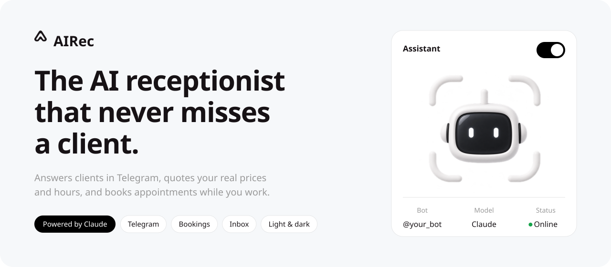
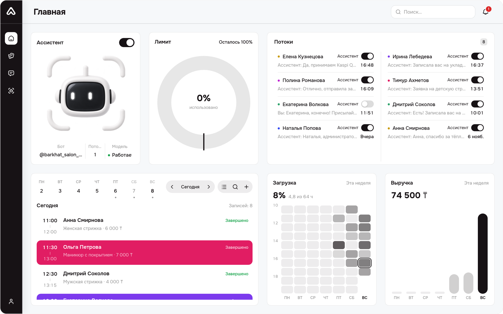
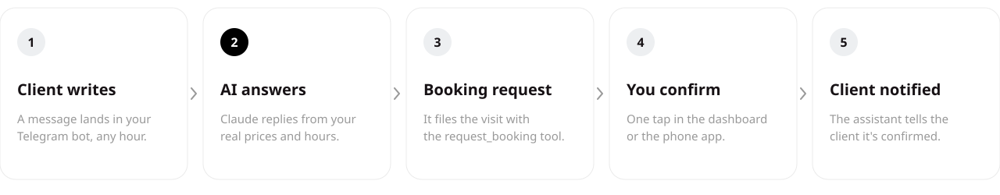
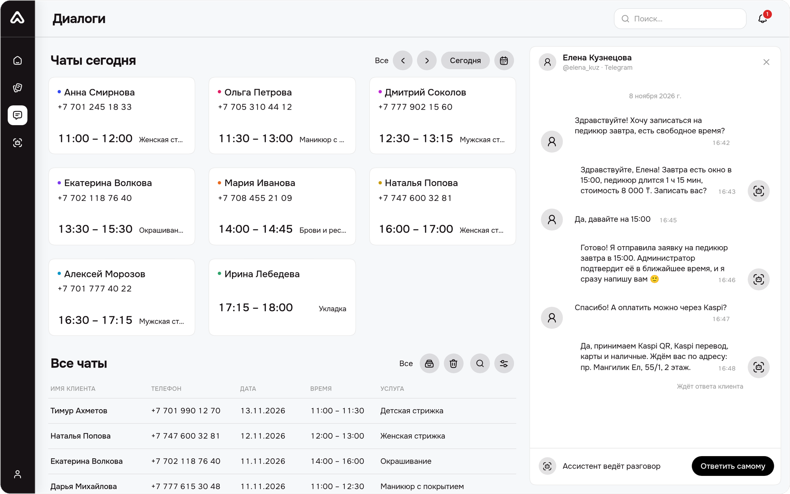
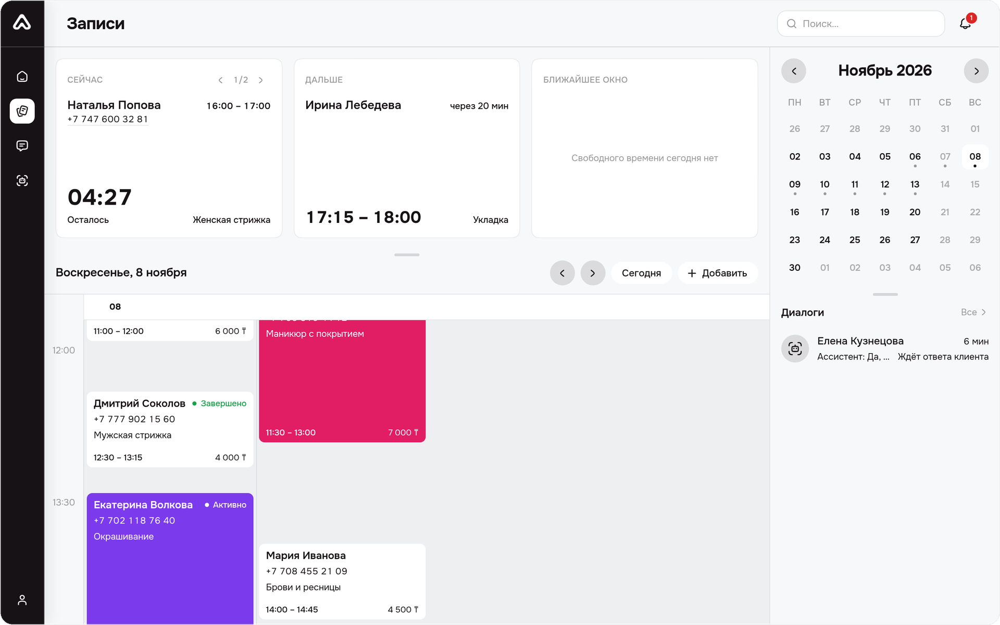
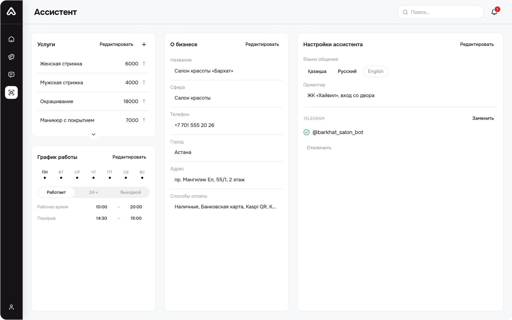
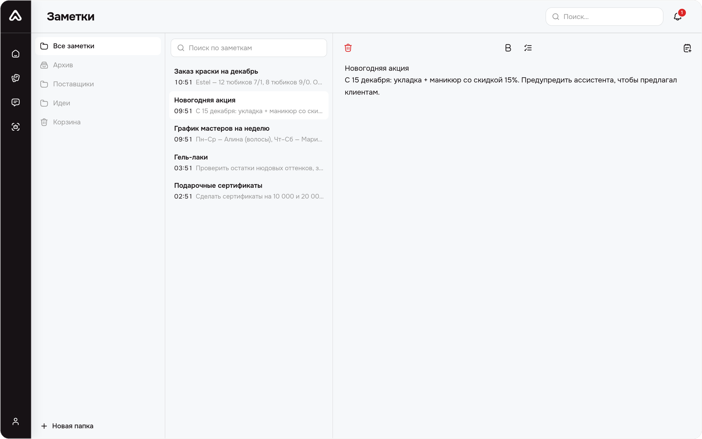
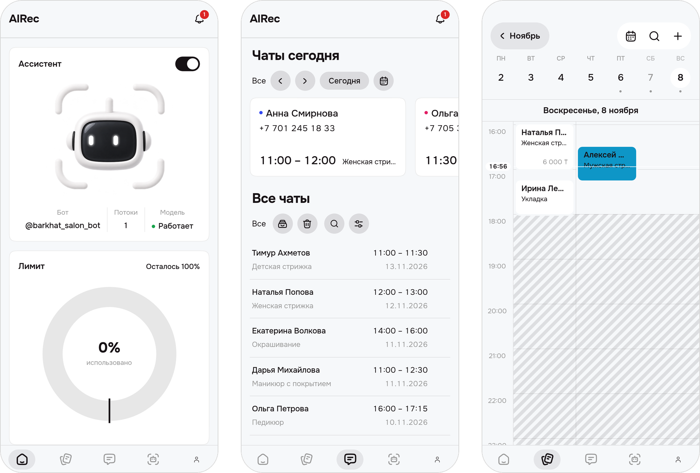
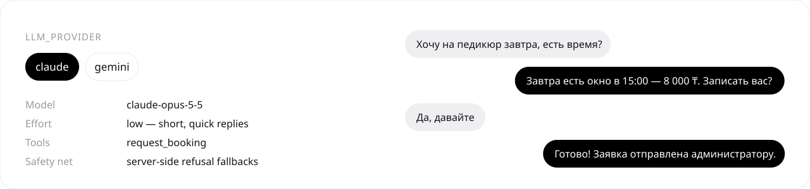
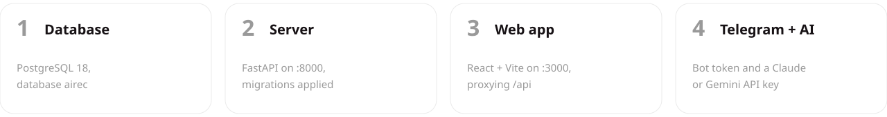

<div align="center">

<picture>
  <source media="(prefers-color-scheme: dark)" srcset="docs/readme/hero-dark.svg">
  
</picture>

<br>

**[Overview](#overview)** · **[How it works](#how-it-works)** · **[Product tour](#product-tour)** · **[Claude](#works-with-claude)** · **[Getting started](#getting-started)** · **[Author](#author)**

<br>

<picture>
  <source media="(prefers-color-scheme: dark)" srcset="docs/readme/screen-dashboard-dark.png">
  
</picture>

</div>

<br>

<a name="overview"></a>
<picture>
  <source media="(prefers-color-scheme: dark)" srcset="docs/readme/title-overview-dark.svg">
  
</picture>

Salons and barbershops lose clients in the gaps: a message at 23:40, a question
during a haircut, a «how much is a manicure?» nobody had time to answer.
**AIRec** is an AI receptionist that sits in the business's Telegram bot and
answers every one of them — politely, instantly, and only with facts the owner
put in: the real price list, the real opening hours, the real free slots.

When a client wants to come in, the assistant doesn't just chat — it **files a
booking request** with the client's name, service, date and time. The owner
sees it in the dashboard, confirms it with one tap, and the assistant tells the
client. The owner can step into any conversation at any moment; the AI steps
back in that thread.

| What you get | How it works |
| --- | --- |
| 🤖 **AI that works from your data** | Prompts are built only from the database — services, prices, hours, the current time in the business's zone. No made-up prices. |
| 📅 **Bookings, not just chat** | A `request_booking` tool turns a conversation into a pending booking that respects opening hours, breaks, capacity and notice rules. |
| 💬 **One inbox** | Every Telegram thread, with archive, bin, search and «Answer myself» to take over from the assistant. |
| 📱 **Built for the phone** | Bottom bar, sheets and swipe gestures instead of a squeezed desktop. Light and dark themes. |
| 🌍 **Three languages** | Russian, Kazakh and English across the UI and API errors. |

<br>

<a name="how-it-works"></a>
<picture>
  <source media="(prefers-color-scheme: dark)" srcset="docs/readme/title-how-dark.svg">
  
</picture>

<picture>
  <source media="(prefers-color-scheme: dark)" srcset="docs/readme/flow-dark.svg">
  
</picture>

The Telegram bot delivers each message to the FastAPI server (webhook, or long
polling in development). The server saves it to the inbox and starts the
assistant in its own task: it reads the last messages of the thread, asks the
language model for a reply, lets the model call `request_booking` if the client
picked a time, and sends the answer back to Telegram. Bursts of messages are
coalesced, and a reply the owner already overtook is dropped.

<br>

<a name="product-tour"></a>
<picture>
  <source media="(prefers-color-scheme: dark)" srcset="docs/readme/title-tour-dark.svg">
  
</picture>

> Screenshots follow your GitHub theme — switch to dark mode to see the dark UI.
> The data is a demo salon.

#### Inbox — every client conversation, with the assistant at work

<picture>
  <source media="(prefers-color-scheme: dark)" srcset="docs/readme/screen-inbox-dark.png">
  
</picture>

#### Bookings — a live timetable with now, next and the nearest free window

<picture>
  <source media="(prefers-color-scheme: dark)" srcset="docs/readme/screen-appointments-dark.png">
  
</picture>

#### Assistant — services, working hours, business profile and the Telegram bot



#### Notes — folders, archive and bin for everything else



#### On the phone

<p align="center">
  
</p>

<br>

<a name="works-with-claude"></a>
<picture>
  <source media="(prefers-color-scheme: dark)" srcset="docs/readme/title-claude-dark.svg">
  
</picture>

<picture>
  <source media="(prefers-color-scheme: dark)" srcset="docs/readme/claude-dark.svg">
  
</picture>

AIRec runs on **Claude** by Anthropic. The language model sits behind one
function (`server/app/core/llm.py`), and the provider is a setting, not an
import — switch it in `.env`:

```env
LLM_PROVIDER=claude
ANTHROPIC_API_KEY=sk-ant-...        # https://platform.claude.com/settings/keys
LLM_CLAUDE_MODEL=claude-opus-5-5
LLM_CLAUDE_EFFORT=low               # a receptionist answers short and fast
```

- **Official SDK.** The Claude adapter uses the [`anthropic`](https://pypi.org/project/anthropic/) Python SDK (async client, typed errors).
- **Tool use.** Claude gets the `request_booking` tool with the service list as an `enum`, so it can't invent a service. Results — including refusals like «outside opening hours» — go back to the model so it can explain them to the client.
- **Safety net.** Server-side refusal fallbacks are on, so a classifier false positive never leaves a client without an answer.
- **Silent when unset.** No key means no replies — messages still land in the inbox, and the dashboard shows the model as off.

Prefer Google's models? `LLM_PROVIDER=gemini` with a `GEMINI_API_KEY` works the
same way. Adding another provider is one function in `llm.py` and a key.

<br>

<a name="getting-started"></a>
<picture>
  <source media="(prefers-color-scheme: dark)" srcset="docs/readme/title-start-dark.svg">
  
</picture>

<picture>
  <source media="(prefers-color-scheme: dark)" srcset="docs/readme/quickstart-dark.svg">
  
</picture>

**You need:** Python 3.12, Node.js 20.19+ (or 22.12+), PostgreSQL 18, a Telegram bot token from
`@BotFather` and an [Anthropic API key](https://platform.claude.com/settings/keys).

**1 · Clone and create the database**

```bash
git clone https://github.com/nurk3ldi/AIRec.git
cd AIRec
createdb -U postgres airec
```

**2 · Start the server** — FastAPI on `http://127.0.0.1:8000`

```bash
cd server
python -m venv .venv
source .venv/bin/activate          # Windows: .venv\Scripts\activate
pip install -r requirements.txt

cp .env.example .env               # then fill it in — see the table below
python -c "import secrets; print(secrets.token_urlsafe(64))"   # → SECRET_KEY

alembic upgrade head
uvicorn app.main:app --reload      # API docs: http://127.0.0.1:8000/docs
```

**3 · Start the web app** — in a second terminal, on `http://localhost:3000`

```bash
cd web
npm install
npm run dev
```

Vite proxies `/api` and `/media` to the server, so there is no CORS to set up —
and the LAN address it prints opens on your phone too.

**4 · Connect Telegram and the AI**

Sign up in the web app, open **Ассистент**, add your services and hours, and
paste the bot token. Without a public URL, set `TELEGRAM_POLLING=true` so the
server asks Telegram for updates instead of waiting for a webhook. Write to your
bot — the assistant answers.

<details>
<summary><b>Environment variables</b> (<code>server/.env</code>)</summary>

<br>

| Variable | What it is |
| --- | --- |
| `DB_HOST` `DB_PORT` `DB_NAME` `DB_USER` `DB_PASSWORD` | PostgreSQL connection (database `airec`) |
| `SECRET_KEY` | JWT signing key, **at least 32 characters** — the app refuses to boot otherwise |
| `LLM_PROVIDER` | `claude` or `gemini` |
| `ANTHROPIC_API_KEY` | Claude key; `LLM_CLAUDE_MODEL` / `LLM_CLAUDE_EFFORT` tune it |
| `GEMINI_API_KEY` | Gemini key, when `LLM_PROVIDER=gemini` |
| `TELEGRAM_POLLING` | `true` for local development without a public URL |
| `PUBLIC_BASE_URL` | Public HTTPS address — Telegram webhooks are registered against it |
| `CORS_ORIGINS` | Allowed web origins (defaults to `http://localhost:3000`) |
| `SMTP_*` | Optional — without `SMTP_HOST`, password-reset codes are printed to the log |
| `GOOGLE_CLIENT_ID` | Optional — enables «Sign in with Google» |

</details>

<details>
<summary><b>Project structure</b></summary>

<br>

```text
AIRec/
├── server/                 FastAPI + SQLAlchemy 2 (async) + PostgreSQL
│   ├── app/api/            HTTP routes (/api/v1)
│   ├── app/services/       business rules: bookings, conversations, assistant
│   ├── app/repositories/   every SQL query
│   ├── app/core/llm.py     the one file that talks to Claude / Gemini
│   ├── app/core/booking_tool.py   the request_booking tool
│   └── alembic/            migrations
├── web/                    React 19 + Vite + Tailwind CSS v4
│   ├── src/pages/          dashboard, inbox, appointments, assistant, notes
│   ├── src/components/     UI, one folder per screen
│   └── src/lib/            API client, auth, dates, booking maths, i18n
└── docs/readme/            the art on this page
```

</details>

<br>

<picture>
  <source media="(prefers-color-scheme: dark)" srcset="docs/readme/stack-dark.svg">
  
</picture>

<br>

<a name="author"></a>
<picture>
  <source media="(prefers-color-scheme: dark)" srcset="docs/readme/title-author-dark.svg">
  
</picture>

<picture>
  <source media="(prefers-color-scheme: dark)" srcset="docs/readme/author-dark.svg">
  
</picture>

AIRec is my own product, made from the first sketch to the last migration by
one person: the idea and the product decisions, the interface design and the
brand, the React app, the FastAPI backend and database, the Telegram channel and
the AI assistant on top of it.

<p>
  <a href="https://github.com/nurk3ldi"><b>GitHub</b></a> ·
  <a href="https://t.me/nurk3ldi"><b>Telegram</b></a> ·
  <a href="https://linkedin.com/in/nurk3ldi"><b>LinkedIn</b></a> ·
  <a href="https://instagram.com/nurk3ldi"><b>Instagram</b></a>
</p>
